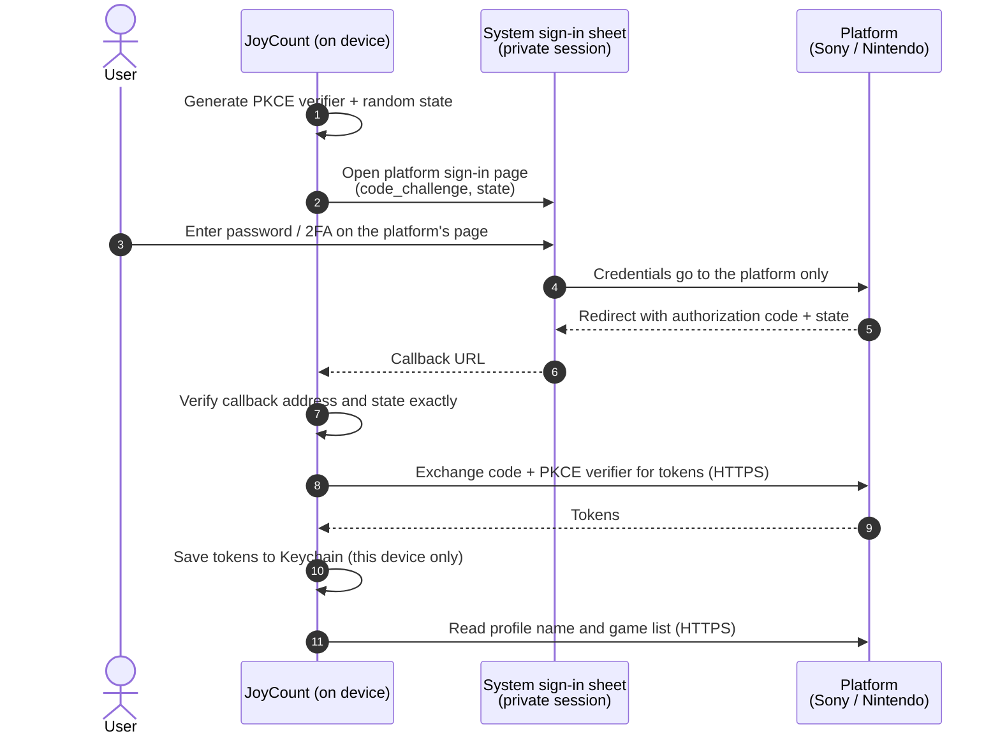
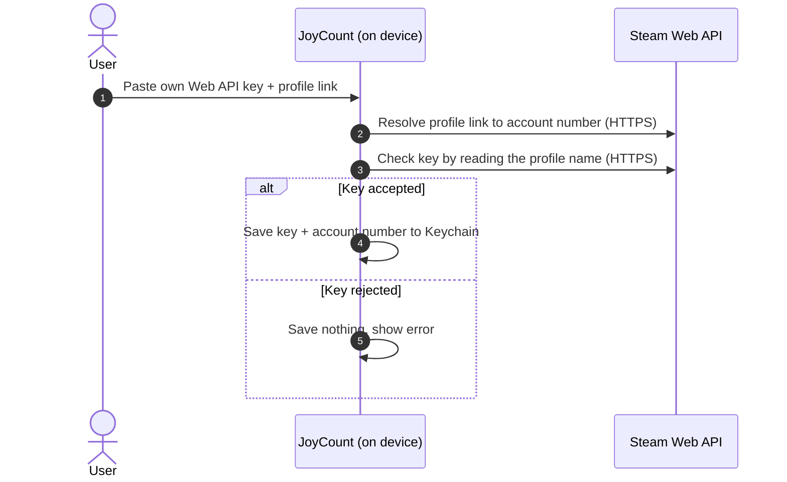

# JoyCount Auto Match — Account Sign-in Security Assessment

[English](README.md) · [简体中文](README.zh-Hans.md)

| | |
|---|---|
| **Document** | JC-SEC-2026-01 |
| **Version** | 1.2 · 22 October 2026 |
| **Product** | JoyCount for iOS and iPadOS, version 3.0.2 |
| **Component** | Auto Match — PlayStation, Nintendo Switch and Steam account linking |
| **Assessment type** | First-party source code review by the JoyCount developer |
| **Status** | Final |

---

## Contents

1. [Executive summary](#1-executive-summary)
2. [Scope and method](#2-scope-and-method)
3. [Architecture and data flow](#3-architecture-and-data-flow)
4. [Threat model](#4-threat-model)
5. [Security controls, with source evidence](#5-security-controls-with-source-evidence)
6. [Findings](#6-findings)
7. [Residual risks for users](#7-residual-risks-for-users)
8. [Revoking access](#8-revoking-access)
9. [Reporting a vulnerability](#9-reporting-a-vulnerability)
10. [Revision history](#10-revision-history)

---

## 1. Executive summary

Auto Match reads the list of games a user owns on PlayStation, Nintendo Switch and Steam, so the user can add them to their JoyCount collection.

This assessment reviewed how JoyCount obtains, stores, uses and deletes the credentials behind that feature. The main conclusions are:

- **Only two parties are involved: the user and the platform they sign in to.** JoyCount runs no server for Auto Match. Every request goes straight from the device to Sony, Nintendo or Valve over HTTPS.
- **JoyCount never handles the user's platform password.** PlayStation and Nintendo sign-in happens on the platform's own web page, in a private system browser session. Steam needs no password at all.
- **Sign-in is protected against forged or intercepted callbacks** by PKCE (S256) and a random `state` value, both made fresh for each attempt and checked strictly when the platform replies.
- **Credentials stay on the device.** They are stored only in the iOS Keychain with *this device only* access. They are never written to iCloud sync data, backups, logs or the widget extension.
- **Unlinking deletes the stored credential immediately.**

The review found **no high or medium severity issues**. It recorded **two low severity** findings, both now **fixed**, and **three informational** findings that need no change ([section 6](#6-findings)). None of them let another party read a user's credentials.

## 2. Scope and method

### In scope

| Area | Source files |
|---|---|
| Sign-in user interface | `Views/AutoMatchView.swift` |
| PlayStation sign-in and library | `Services/PSNLibraryProvider.swift` |
| Nintendo sign-in and library | `Services/NintendoLibraryProvider.swift` |
| Steam linking and library | `Services/SteamLibraryProvider.swift` |
| Credential storage | `Services/AutoMatchCredentialStore.swift` |
| Network client | `Services/AutoMatchHTTPClient.swift` |
| Artwork download | `Services/AutoMatchCoverFetcher.swift` |
| Account lifecycle | `Services/AutoMatchCoordinator.swift` |

### Out of scope

The platforms' own servers and sign-in pages; iOS itself; JoyCount features other than Auto Match.

### Method

1. Manual line-by-line review of every file listed above.
2. A list of every network address the component contacts, checked against platform ownership.
3. A trace of every credential from the moment it is created to the moment it is deleted.
4. A check of the app's network security settings (App Transport Security).

The code excerpts in this report are taken from the reviewed build. They have been shortened, and comments translated, for readability. Non-security details such as the platforms' public app identifiers are left out.

## 3. Architecture and data flow

### 3.1 PlayStation and Nintendo



### 3.2 Steam



### 3.3 Network addresses

| Platform | Purpose | Host | Owner |
|---|---|---|---|
| PlayStation | Sign-in and tokens | `ca.account.sony.com` | Sony |
| PlayStation | Profile and games | `m.np.playstation.com` | Sony |
| Nintendo | Sign-in and tokens | `accounts.nintendo.com`, `api.accounts.nintendo.com` | Nintendo |
| Nintendo | Play history | `app-api.znej.nintendo.com` | Nintendo |
| Nintendo | Store data and artwork | `ec.nintendo.com`, `*.cdn.nintendo.net` | Nintendo |
| Steam | Web API | `api.steampowered.com` | Valve |
| Steam | Artwork | `*.steamstatic.com` | Valve |

No other hosts are contacted by Auto Match.

## 4. Threat model

| ID | Threat | Example | Mitigation | Section |
|---|---|---|---|---|
| T1 | Password captured by the app | App shows its own login form | Sign-in only on the platform's page in a system sheet | 5.1 |
| T2 | Session reused or mixed up | Second account signs in as the first | Private (ephemeral) browser session | 5.1 |
| T3 | Authorization code intercepted | Another app registers the same callback | PKCE S256 binds the code to this device | 5.2 |
| T4 | Forged sign-in reply (CSRF) | A web link opens the callback with a planted code | Random `state`, checked exactly | 5.2, 5.3 |
| T5 | Credentials copied off the device | Through iCloud sync, backup or file sharing | Keychain, *this device only*, never in sync data | 5.4 |
| T6 | Credentials sent in clear text | Network on public Wi-Fi | HTTPS only, enforced by iOS | 5.5 |
| T7 | Credentials leak to another host | Artwork server receives a token | Tokens sent only to platform API hosts | 5.5 |
| T8 | Credentials left behind | User unlinks but key stays | Unlink deletes the Keychain item | 5.6 |
| T9 | Bad key saved | Typo stored and retried forever | Key verified with Steam before saving | 5.7 |
| T10 | Server text injected into the UI | Misleading error message | Platform error descriptions are never shown | 5.3 |

## 5. Security controls, with source evidence

### 5.1 Sign-in on the platform's own page, in a private session (T1, T2)

JoyCount has no password field for PlayStation or Nintendo. It uses `ASWebAuthenticationSession`, the iOS system sign-in sheet. The app cannot read or change what the user types into it. `prefersEphemeralWebBrowserSession` makes iOS start a clean session with no shared cookies, and throw it away afterwards.

```swift
// Views/AutoMatchView.swift — AutoMatchWebLogin
private func present(url: URL, scheme: String) async throws -> URL {
    try await withCheckedThrowingContinuation { continuation in
        let session = ASWebAuthenticationSession(url: url, callbackURLScheme: scheme) { callbackURL, error in
            if let error {
                continuation.resume(throwing: error)
            } else if let callbackURL {
                continuation.resume(returning: callbackURL)
            } else {
                continuation.resume(throwing: AutoMatchError.invalidResponse)
            }
        }
        session.presentationContextProvider = AutoMatchPresentationAnchorProvider.shared
        // Private session: no cookies from Safari or from an earlier sign-in.
        session.prefersEphemeralWebBrowserSession = true
        self.session = session
        if !session.start() {
            continuation.resume(throwing: AutoMatchError.server("session"))
        }
    }
}
```

If the user leaves the screen, the pending sign-in is cancelled (`webLogin.cancel()` in `onDisappear`).

### 5.2 PKCE and `state` made fresh for every attempt (T3, T4)

Each sign-in creates a new 256-bit PKCE verifier and a new random `state` from the system's secure random number generator. Only the SHA-256 hash of the verifier (the *challenge*) goes into the sign-in address. The verifier itself stays in memory and is sent only once, in the HTTPS code exchange. An intercepted authorization code is useless without it.

```swift
// Services/PSNLibraryProvider.swift
static func makeAuthorizationRequest() throws -> (url: URL, state: String, codeVerifier: String) {
    let verifier  = try Self.randomURLSafeString(byteCount: 32)   // 256-bit secret, never leaves memory
    let challenge = Self.sha256Base64URL(verifier)                // only the hash is sent
    let state     = try Self.randomURLSafeString(byteCount: 16)

    var components = URLComponents(string: Self.authBase + "/authorize")
    components?.queryItems = [
        URLQueryItem(name: "response_type",         value: "code"),
        URLQueryItem(name: "redirect_uri",          value: Self.redirectURI),
        URLQueryItem(name: "code_challenge",        value: challenge),
        URLQueryItem(name: "code_challenge_method", value: "S256"),
        URLQueryItem(name: "state",                 value: state),
        // client_id and scope omitted
    ]
    guard let url = components?.url else { throw AutoMatchError.invalidURL }
    return (url, state, verifier)
}

static func randomURLSafeString(byteCount: Int) throws -> String {
    var bytes = [UInt8](repeating: 0, count: byteCount)
    // If the system generator ever fails, refuse to sign in rather than
    // fall back to predictable bytes (finding JC-02, fixed).
    guard SecRandomCopyBytes(kSecRandomDefault, byteCount, &bytes) == errSecSuccess else {
        throw AutoMatchError.server("random")
    }
    return Data(bytes).base64URLEncodedString()
}

static func sha256Base64URL(_ input: String) -> String {
    Data(SHA256.hash(data: Data(input.utf8))).base64URLEncodedString()
}
```

Nintendo uses the same pattern with a 288-bit `state`. Nintendo names the PKCE fields differently (`session_token_code_challenge`), but the protection is the same.

### 5.3 Strict checks on the sign-in reply (T4, T10)

The reply from the platform arrives as a URL that any app or web page could also try to open, so JoyCount treats it as untrusted input. For PlayStation, every part of the reply must match exactly before the code is accepted:

```swift
// Services/PSNLibraryProvider.swift
static func authorizationCode(from url: URL, expectedState: String) throws -> String {
    guard let allowed  = URLComponents(string: redirectURI),
          let callback = URLComponents(url: url, resolvingAgainstBaseURL: false),
          callback.scheme?.lowercased() == allowed.scheme?.lowercased(),
          callback.host?.lowercased()   == allowed.host?.lowercased(),
          callback.percentEncodedPath.isEmpty || callback.percentEncodedPath == "/",
          callback.user == nil, callback.password == nil,
          callback.port == nil, callback.fragment == nil,
          !expectedState.isEmpty else {
        throw AutoMatchError.invalidResponse
    }

    let items  = callback.queryItems ?? []
    let states = items.filter { $0.name == "state" }
    let codes  = items.filter { $0.name == "code" }
    let errors = items.filter { $0.name == "error" }

    // Exactly one state, and it must be ours. No duplicated parameters.
    // A reply carries either a code or an error, never both.
    guard states.count == 1, states.first?.value == expectedState,
          codes.count <= 1, errors.count <= 1,
          codes.isEmpty || errors.isEmpty else {
        throw AutoMatchError.invalidResponse
    }

    if let error = errors.first {
        // error_description is untrusted server text: never shown in the UI.
        if error.value == "login_required" || error.value == "invalid_grant" {
            throw AutoMatchError.reauthRequired(.playStation)
        }
        throw AutoMatchError.server(error.value ?? "unknown")
    }

    guard let code = codes.first?.value, !code.isEmpty else {
        throw AutoMatchError.invalidResponse
    }
    return code
}
```

The Nintendo check applies the same rules: scheme, host and path must match, and `state` and the code must each appear exactly once (finding JC-01, fixed).

```swift
// Services/NintendoLibraryProvider.swift
// Nintendo returns its parameters in the URL fragment, so fragment and query
// are read together, and each parameter must appear exactly once across both.
let states = items.filter { $0.name == "state" }
let codes  = items.filter { $0.name == "session_token_code" }
guard states.count == 1, states.first?.value == expectedState,
      codes.count == 1, let code = codes.first?.value, !code.isEmpty else {
    throw AutoMatchError.invalidResponse
}
return code
```

### 5.4 Keychain storage, this device only, never synced (T5)

All Auto Match credentials go through a single type, `AutoMatchCredential`, which is only ever written to the Keychain. Each linked account has its own Keychain item.

```swift
// Services/AutoMatchCredentialStore.swift
func save(_ credential: AutoMatchCredential, key: String) throws {
    let data = try JSONEncoder().encode(credential)
    let attributes: [String: Any] = [kSecValueData as String: data]
    let updateStatus = SecItemUpdate(baseQuery(key: key) as CFDictionary, attributes as CFDictionary)
    if updateStatus == errSecSuccess { return }
    guard updateStatus == errSecItemNotFound else {
        throw AutoMatchKeychainError(status: updateStatus, operation: "update")
    }

    var addQuery = baseQuery(key: key)
    addQuery[kSecValueData as String] = data
    // Readable after first unlock; never synced to iCloud Keychain,
    // never restored onto a different device.
    addQuery[kSecAttrAccessible as String] = kSecAttrAccessibleAfterFirstUnlockThisDeviceOnly
    let addStatus = SecItemAdd(addQuery as CFDictionary, nil)
    guard addStatus == errSecSuccess else {
        throw AutoMatchKeychainError(status: addStatus, operation: "add")
    }
}
```

The design rules are:

- **Not shared with extensions.** No Keychain access group is declared for these items. The widget extension cannot read them.
- **Never in iCloud sync data.** JoyCount's iCloud sync files can be seen by the user in the Files app. Credentials are kept out of that format on purpose, and the sync code has no reference to `AutoMatchCredential`.
- **Account list is kept apart from secrets.** The list of linked accounts (display name and account number only) is kept in local app settings, with no token or key.
- **Safe migration.** When credentials are moved from the old storage format, the new item is written before the old one is deleted. A failure never loses a credential.

### 5.5 Transport security (T6, T7)

- The app declares **no App Transport Security exceptions** (`NSAppTransportSecurity` is absent). iOS therefore refuses any non-HTTPS connection, and any HTTPS connection without a valid certificate, before a request is sent.
- Every Auto Match address is a hard-coded `https://` constant pointing at the platform (section 3.3).
- **Tokens and keys are sent only to platform API hosts.** The artwork downloader builds its own plain request that carries no credential:

```swift
// Services/AutoMatchCoverFetcher.swift
var request = URLRequest(url: cover.url)
request.timeoutInterval = 30
request.setValue("image/*", forHTTPHeaderField: "Accept")   // no Authorization header, no key
let (data, response) = try await session.data(for: request)
```

- The app never builds credentials into its binary. The shared HTTP client has no fallback key. Every credential it uses belongs to the user.

### 5.6 Unlinking deletes the credential (T8)

```swift
// Services/AutoMatchCoordinator.swift
func unlink(_ account: AutoMatchAccount) {
    provider(for: account).disconnect()   // SecItemDelete on this account's Keychain item
    AutoMatchAccountStore.remove(account)
    AutoMatchSeenGames.removeBaseline(for: account)
    snapshot.removeAccount(account.id)
    persist()
    reloadAccounts()
    rebuildDrafts()
}
```

Deleting an item that is already gone counts as success, so unlinking always completes. Games already in the user's collection are kept, because they are the user's own records.

### 5.7 Steam key is verified before it is saved (T9)

```swift
// Services/SteamLibraryProvider.swift
static func link(apiKey: String, accountInput: String, /* … */) async throws -> AutoMatchAccount {
    let trimmedKey = apiKey.trimmingCharacters(in: .whitespacesAndNewlines)
    guard !trimmedKey.isEmpty else { throw AutoMatchError.invalidSteamKey }

    let steamID = try await probe.resolveSteamID(accountInput, apiKey: trimmedKey)
    // Ask Steam for this profile's name with the key. If Steam rejects the key,
    // or the profile does not match, stop here: nothing is written.
    guard let summary = try await probe.playerSummary(steamID: steamID, apiKey: trimmedKey),
          let personaName = summary.personaname, !personaName.isEmpty else {
        throw AutoMatchError.invalidSteamKey
    }

    let account = AutoMatchAccountStore.upsert(
        AutoMatchAccount(platform: .steam, displayName: personaName, externalAccountID: steamID)
    )
    var credential = AutoMatchCredential()
    credential.apiKey      = trimmedKey
    credential.accountID   = steamID
    credential.accountName = personaName
    try credentials.save(credential, for: account)
    return account
}
```

The Steam key field is a `SecureField`, so the key is hidden on screen and kept out of the system's autocorrection and suggestions.

## 6. Findings

Severity follows a four-level scale: **High** (credentials can be obtained by another party), **Medium** (credentials exposed under realistic conditions), **Low** (defence-in-depth gap with no known path to exposure), and **Informational** (design note, no change needed).

| ID | Title | Severity | Status |
|---|---|---|---|
| JC-01 | Nintendo callback check is less strict than PlayStation's | Low | **Fixed** |
| JC-02 | Return value of the secure random generator is not checked | Low | **Fixed** |
| JC-03 | Steam Web API key travels in the request address | Informational | Accepted (platform requirement) |
| JC-04 | PlayStation and Nintendo interfaces are not public | Informational | Accepted, disclosed to users |
| JC-05 | Artwork addresses from the platform are not limited to a host list | Informational | Accepted |

*Fixed* means fixed in the source code. The fixes reach users in the next App Store update after 3.0.2. The descriptions below explain the behaviour as it was in 3.0.2.

### JC-01 · Nintendo callback check is less strict than PlayStation's — Low

**Description.** The Nintendo callback check verifies the scheme, host and exact `state`, but takes the *first* `state` and `session_token_code` it finds instead of rejecting repeated parameters, and it does not check the path.

**Impact.** No path to exposure is known. A planted callback would still need the correct random `state` for the attempt in progress, and the code exchange would still need the PKCE verifier, which never leaves memory.

**Resolution.** The Nintendo check now applies the same scheme, host, path and parameter-count rules as PlayStation. A reply with a repeated `state` or code, including one repeated across the fragment and the query, is rejected. Covered by automated tests (section 5.3).

### JC-02 · Return value of the secure random generator is not checked — Low

**Description.** `SecRandomCopyBytes` returns a status code that is currently ignored (section 5.2). If it ever failed, the PKCE verifier and `state` would be predictable.

**Impact.** On iOS this call is not known to fail in normal operation. The sign-in would also need to be intercepted at the same moment.

**Resolution.** The return value is now checked for both platforms. If the call fails, the sign-in stops with an error and nothing is sent to the platform (section 5.2).

### JC-03 · Steam Web API key travels in the request address — Informational

**Description.** Steam's Web API requires the key as a `key=` query parameter.

**Impact.** The address is encrypted by HTTPS on the network. JoyCount does not log request addresses and sends the key only to `api.steampowered.com`.

**Recommendation.** None for the app. Users should treat the key like a password (section 7).

### JC-04 · PlayStation and Nintendo interfaces are not public — Informational

**Description.** These platforms do not offer a public game library interface for apps like JoyCount. Auto Match uses the same sign-in and library interfaces as the platform's own mobile app.

**Impact.** This is a reliability matter, not a confidentiality one: the platform may change or block the interface at any time. The app tells users this, and a failure only shows an error. The user's collection is never changed.

### JC-05 · Artwork addresses from the platform are not limited to a host list — Informational

**Description.** For PlayStation, artwork addresses come from the platform's own reply and are downloaded without a host list.

**Impact.** These requests carry no credential (section 5.5), and the address only comes from an authenticated HTTPS reply from the platform.

## 7. Residual risks for users

- **Treat your Steam Web API key like a password.** A key can read any *public* Steam profile. Do not share it or paste it into other places.
- **Steam game details must be public** in Steam's privacy settings for Auto Match to see your games. This makes the game list visible to anyone, not only to JoyCount.
- **Someone who can unlock your device** can use JoyCount like you can. Credentials are protected by the iOS Keychain and your device passcode.
- **PlayStation and Nintendo sign-in may stop working** if the platform changes its interface (JC-04).

## 8. Revoking access

| Where | How | Effect |
|---|---|---|
| JoyCount | Auto Match → account → **Unlink** | Credential deleted from the Keychain at once; collection kept |
| PlayStation | Sony account security settings → sign out of all devices, or change password | Tokens held by JoyCount stop working |
| Nintendo | Nintendo Account sign-in and security settings → sign out of all devices, or change password | Session held by JoyCount stops working |
| Steam | `steamcommunity.com/dev/apikey` → revoke key | Key stops working at once |

## 9. Reporting a vulnerability

If you believe you have found a security issue in Auto Match, please open an issue in this repository describing the problem and how to reproduce it. **Never include tokens, API keys or passwords** in a report.

## 10. Revision history

| Version | Date | Changes |
|---|---|---|
| 1.0 | 22 Oct 2026 | First publication |
| 1.1 | 22 Oct 2026 | Added architecture diagrams, threat model, source code evidence and formal findings |
| 1.2 | 22 Oct 2026 | JC-01 and JC-02 fixed; code evidence updated |
