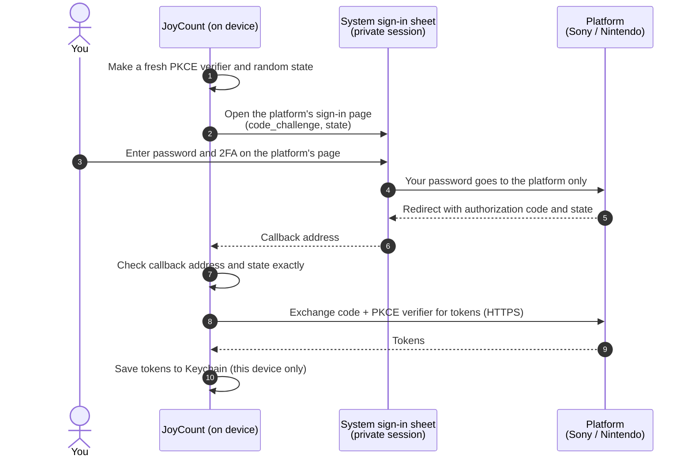
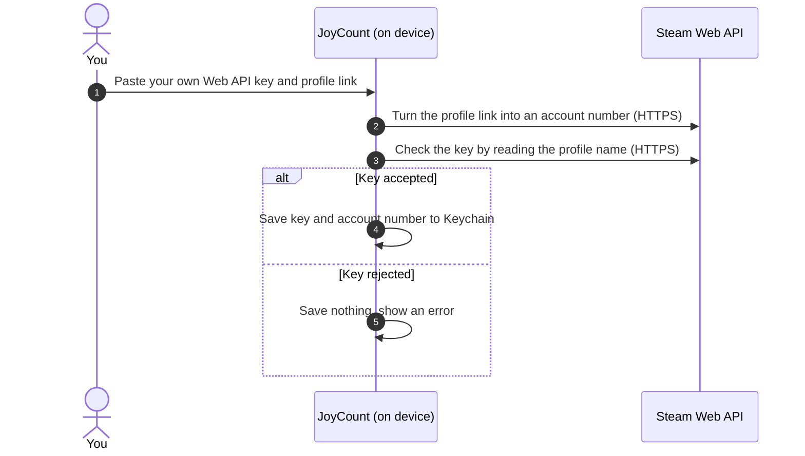
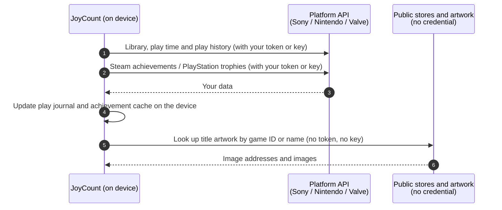

# JoyCount 3.1 — Security & Privacy Report

[English](README.md) · [简体中文](README.zh-Hans.md)

| | |
|---|---|
| **Document** | JC-SEC-2026-02 |
| **Version** | 1.0 · 30 October 2026 |
| **Product** | JoyCount for iOS and iPadOS, version 3.1 |
| **Components** | Linked accounts (PlayStation, Nintendo Switch, Steam) as used by Auto Match and the new Stats tab |
| **Assessment type** | First-party source code review by the JoyCount developer |
| **Replaces** | JC-SEC-2026-01 (Auto Match sign-in assessment for 3.0.2) |
| **Status** | Final |

---

## Contents

1. [Summary](#1-summary)
2. [What is new in 3.1](#2-what-is-new-in-31)
3. [Scope and method](#3-scope-and-method)
4. [What data is involved](#4-what-data-is-involved)
5. [How data moves](#5-how-data-moves)
6. [Threat model](#6-threat-model)
7. [Security controls, with source evidence](#7-security-controls-with-source-evidence)
8. [Findings](#8-findings)
9. [What you should know](#9-what-you-should-know)
10. [Removing your data and revoking access](#10-removing-your-data-and-revoking-access)
11. [Reporting a vulnerability](#11-reporting-a-vulnerability)
12. [Revision history](#12-revision-history)

---

## 1. Summary

JoyCount lets you link your PlayStation, Nintendo Switch and Steam accounts. **Auto Match** uses those accounts to find games you own and add them to your collection. In 3.1 the same accounts also power the new **Stats** tab, which shows play time, daily activity and achievements.

The main conclusions of this review are:

- **JoyCount has no server.** Everything happens on your device. Requests go straight from the device to Sony, Nintendo or Valve over HTTPS. The developer never receives your accounts, your play history or your achievements.
- **JoyCount never sees your platform password.** PlayStation and Nintendo sign-in happens on the platform's own page, in a private system sign-in sheet. Steam uses an API key that you create yourself.
- **Credentials stay in this device's Keychain.** They are marked *this device only*, so they are not synced to iCloud Keychain, not restored onto another device, and not readable by the widget. They are never put in iCloud sync data, backups made by JoyCount, Excel exports or diagnostics logs.
- **Stats adds no new place your credentials go.** The new play time, trophy and achievement requests go to the same Sony, Nintendo and Valve hosts that Auto Match already used.
- **Play history and achievements stay on the device.** They are kept in local files, not synced with iCloud, and deleted when you unlink the account.

This review found **no high or medium severity issues**. The two low severity issues from the 3.0.2 review (JC-01, JC-02) are fixed, and 3.1 is the first App Store version that includes those fixes. One new low severity issue (JC-07) was found and fixed before release. Four informational findings need no code change and are explained in [section 8](#8-findings).

## 2. What is new in 3.1

| Change | Security and privacy effect |
|---|---|
| **Stats tab** reads play time, first and last played dates, and daily play minutes | Uses the existing linked accounts. No new sign-in and no new credential. |
| **Achievements and trophies** (Steam achievements, PlayStation trophies) | New requests to `api.steampowered.com` and `m.np.playstation.com`, the same hosts as before. |
| **Play journal**: a daily record of play minutes built on the device | Stored only on the device. Removed for an account when it is unlinked. |
| **Game title artwork** for Stats | Public store lookups that carry **no credential**. One lookup uses a community service, `api.steamcmd.net` (JC-06). |
| **Linked Accounts page** in Stats | Same accounts and the same Keychain items as Auto Match. Linking or unlinking in one place applies to both. |
| Stricter Nintendo sign-in check (JC-01) | Fixed after 3.0.2; first shipped in 3.1. |
| Secure random check (JC-02) | Fixed after 3.0.2; first shipped in 3.1. |
| Unlinking clears the achievement summary at once (JC-07) | Fixed in 3.1. |

## 3. Scope and method

### In scope

| Area | Source files |
|---|---|
| Sign-in and account screens | `Views/AutoMatchView.swift`, `Views/StatsView.swift` |
| PlayStation sign-in, library and trophies | `Services/PSNLibraryProvider.swift` |
| Nintendo sign-in, library and play history | `Services/NintendoLibraryProvider.swift` |
| Steam linking, library and achievements | `Services/SteamLibraryProvider.swift` |
| Credential storage | `Services/AutoMatchCredentialStore.swift` |
| Network client | `Services/AutoMatchHTTPClient.swift` |
| Account lifecycle | `Services/AutoMatchCoordinator.swift` |
| Play journal and achievement cache | `Services/PlayActivityJournal.swift`, `Services/PlayAchievementDetails.swift` |
| Stats artwork | `Services/StatsArtworkLookup.swift`, `Services/AutoMatchCoverFetcher.swift` |
| iCloud sync isolation | `Services/CloudSyncEngine.swift` |

### Out of scope

The platforms' own servers and sign-in pages; iOS itself; JoyCount features that do not use linked accounts, such as cover search, Smart Import and iCloud sync of your collection records.

### Method

1. Line-by-line review of every file listed above, including all changes since 3.0.2.
2. A list of every network host these components contact, checked for who owns it and what it receives.
3. A trace of every credential and every piece of play data, from creation to deletion.
4. A check of the app's network security settings, Keychain settings and entitlements.

Code excerpts are taken from the 3.1 build. They are shortened, and comments are translated, for readability.

## 4. What data is involved

| Data | Where it comes from | Where it is kept | Leaves the device? |
|---|---|---|---|
| PlayStation and Nintendo sign-in tokens | The platform, after you sign in on its page | Keychain, *this device only* | Only to the platform that issued it |
| Steam Web API key and Steam account number | You paste them in | Keychain, *this device only* | Only to `api.steampowered.com` |
| Linked account list (name and account number) | The platform | Local app settings | No |
| Game library, play time, first and last played | The platform | `Application Support/AutoMatch` | No |
| Daily play minutes (play journal) | Built on the device from what the platform reports | `Application Support/AutoMatch/play-journal.json` | No |
| Achievements and trophies | Steam and PlayStation | `Application Support/AutoMatch` | No |
| Artwork | Platform and store servers | `Application Support/AutoMatch` | No |

Nothing in this table is sent to the JoyCount developer. Files in `Application Support` are part of the normal iPhone or iPad backup that iOS makes, like any app's data. Keychain items marked *this device only* are not restored from a backup onto a different device.

## 5. How data moves

### 5.1 PlayStation and Nintendo sign-in



### 5.2 Steam linking



### 5.3 Stats refresh (new in 3.1)



### 5.4 Network hosts

| Platform | Purpose | Host | Owner | Carries a credential |
|---|---|---|---|---|
| PlayStation | Sign-in and tokens | `ca.account.sony.com` | Sony | Yes |
| PlayStation | Profile, games, play time, trophies | `m.np.playstation.com` | Sony | Yes |
| PlayStation | Store search for title artwork | `web.np.playstation.com` | Sony | No |
| Nintendo | Sign-in and tokens | `accounts.nintendo.com`, `api.accounts.nintendo.com` | Nintendo | Yes |
| Nintendo | Play history | `app-api.znej.nintendo.com` | Nintendo | Yes |
| Nintendo | Store data and artwork | `ec.nintendo.com`, `www.nintendo.com.hk`, `*.cdn.nintendo.net` | Nintendo | No |
| Steam | Web API: library, profile, achievements | `api.steampowered.com` | Valve | Yes |
| Steam | Store search for title artwork | `store.steampowered.com` | Valve | No |
| Steam | Artwork | `*.steamstatic.com` | Valve | No |
| Steam | Title logo lookup | `api.steamcmd.net` | Community service, not Valve | No (JC-06) |

No other hosts are contacted by these components.

## 6. Threat model

| ID | Threat | Example | Mitigation | Section |
|---|---|---|---|---|
| T1 | Password captured by the app | App shows its own login form | Sign-in only on the platform's page, in a system sheet | 7.1 |
| T2 | Session reused or mixed up | A second account signs in as the first | Private (ephemeral) sign-in session | 7.1 |
| T3 | Authorization code intercepted | Another app claims the same callback | PKCE S256 ties the code to this attempt | 7.2 |
| T4 | Forged sign-in reply | A web link opens the callback with a planted code | Random `state`, checked exactly | 7.2, 7.3 |
| T5 | Credentials copied off the device | Through iCloud sync, backup or file sharing | Keychain, *this device only*, never in sync data | 7.4 |
| T6 | Credentials sent in clear text | Public Wi-Fi | HTTPS only, enforced by iOS | 7.5 |
| T7 | Credentials sent to the wrong host | An artwork server receives a token | Credentials only go to platform API hosts | 7.5, 7.6 |
| T8 | Data left behind after unlinking | Key or play history remains | Unlink deletes the credential, play journal and achievement data | 7.7 |
| T9 | Play history shared without consent | Activity synced or uploaded | Play data stays in local files, never synced or uploaded | 7.8 |
| T10 | Server text shown in the app | Misleading error message | Platform error descriptions are never shown | 7.3 |

## 7. Security controls, with source evidence

### 7.1 Sign-in on the platform's own page, in a private session (T1, T2)

JoyCount has no password field for PlayStation or Nintendo. It uses `ASWebAuthenticationSession`, the iOS system sign-in sheet, which the app cannot read or change. With `prefersEphemeralWebBrowserSession`, iOS starts a clean session with no shared cookies and throws it away afterwards.

```swift
// Views/AutoMatchView.swift — AutoMatchWebLogin
let session = ASWebAuthenticationSession(url: url, callbackURLScheme: scheme) { callbackURL, error in
    // …
}
session.presentationContextProvider = AutoMatchPresentationAnchorProvider.shared
// Private session: no cookies from Safari or from an earlier sign-in.
session.prefersEphemeralWebBrowserSession = true
```

Stats does not add a second sign-in. Its Linked Accounts page opens the same account screens as Auto Match.

### 7.2 PKCE and `state` made fresh for every attempt (T3, T4)

Each sign-in makes a new 256-bit PKCE verifier and a new random `state` with the system's secure random generator. Only the SHA-256 hash of the verifier goes into the sign-in address. If the generator fails, sign-in stops instead of using predictable values (JC-02, fixed).

```swift
// Services/PSNLibraryProvider.swift
let verifier  = try Self.randomURLSafeString(byteCount: 32)   // 256-bit secret, stays in memory
let challenge = Self.sha256Base64URL(verifier)                // only the hash is sent
let state     = try Self.randomURLSafeString(byteCount: 16)

static func randomURLSafeString(byteCount: Int) throws -> String {
    var bytes = [UInt8](repeating: 0, count: byteCount)
    guard SecRandomCopyBytes(kSecRandomDefault, byteCount, &bytes) == errSecSuccess else {
        throw AutoMatchError.server("random")
    }
    return Data(bytes).base64URLEncodedString()
}
```

Nintendo uses the same pattern with a 288-bit `state`.

### 7.3 Strict checks on the sign-in reply (T4, T10)

The reply arrives as an address that any app or web page could try to open, so JoyCount treats it as untrusted. For both PlayStation and Nintendo, the scheme, host and path must match exactly, and `state` and the code must each appear exactly once. Nintendo was brought up to this standard after 3.0.2 (JC-01, fixed).

```swift
// Services/NintendoLibraryProvider.swift
// Nintendo puts its parameters in the URL fragment, so fragment and query are
// read together, and each parameter must appear exactly once across both.
let states = items.filter { $0.name == "state" }
let codes  = items.filter { $0.name == "session_token_code" }
guard states.count == 1, states.first?.value == expectedState,
      codes.count == 1, let code = codes.first?.value, !code.isEmpty else {
    throw AutoMatchError.invalidResponse
}
```

Error descriptions sent by the platform are never shown in the app.

### 7.4 Keychain storage, this device only, never synced (T5)

All credentials go through one type, `AutoMatchCredential`, which is only ever written to the Keychain, one item per linked account. This code is unchanged since 3.0.2.

```swift
// Services/AutoMatchCredentialStore.swift
var addQuery = baseQuery(key: key)
addQuery[kSecValueData as String] = data
// Readable after first unlock; never synced to iCloud Keychain,
// never restored onto a different device.
addQuery[kSecAttrAccessible as String] = kSecAttrAccessibleAfterFirstUnlockThisDeviceOnly
```

- **No Keychain access group** is declared, so the widget extension cannot read these items.
- **Never in iCloud sync data, Excel backups or diagnostics logs.** None of that code refers to `AutoMatchCredential`.
- **The account list holds no secrets.** It keeps only the display name and account number.

### 7.5 Transport security (T6, T7)

- The app declares **no App Transport Security exceptions**. iOS refuses any connection that is not HTTPS with a valid certificate.
- Every address in [section 5.4](#54-network-hosts) is a fixed `https://` constant.
- Request addresses, tokens and keys are not written to logs.

### 7.6 Stats artwork requests carry no credential (T7)

Title artwork for Stats is looked up in public stores. These requests are made without any token or key. For example, the Steam logo lookup:

```swift
// Services/StatsArtworkLookup.swift
guard let url = URL(string: "https://api.steamcmd.net/v1/info/\(appID)") else { throw AutoMatchError.invalidURL }
// No headers: no token, no Steam key. Only the public game ID is sent.
let envelope = try await AutoMatchHTTPClient().getJSON(url, as: SteamCMDEnvelope.self, timeout: 10)
```

Images are downloaded with a plain request that only asks for an image:

```swift
// Services/AutoMatchCoverFetcher.swift
var request = URLRequest(url: url)
request.setValue("image/*", forHTTPHeaderField: "Accept")   // no Authorization header, no key
```

### 7.7 Unlinking deletes the credential and the play data (T8)

```swift
// Services/AutoMatchCoordinator.swift
func unlink(_ account: AutoMatchAccount) {
    provider(for: account).disconnect()          // deletes this account's Keychain item
    AutoMatchAccountStore.remove(account)
    AutoMatchSeenGames.removeBaseline(for: account)
    snapshot.removeAccount(account.id)           // games only this account owns
    persist()
    PlayActivityJournalStore.prune(account: account.id, platform: platform, keeping: snapshot.games)
    PlayAchievementDetailStore.removeAccount(account.id)   // per-game achievement lists
    PlayAchievementStore.removeAccount(account.id)         // achievement summary (JC-07, fixed)
    reloadAccounts()
    rebuildDrafts()
}
```

Deleting an item that is already gone counts as success, so unlinking always completes. Games already in your collection are kept, because they are your own records.

### 7.8 Play data stays on the device (T9)

The play journal, achievement cache and Stats artwork cache are plain local files in the app's `Application Support/AutoMatch` folder. They are not part of JoyCount's iCloud sync format, are not included in Excel exports, and are never uploaded anywhere. JoyCount has no analytics or tracking for this data.

### 7.9 The Steam key is checked before it is saved

When you link Steam, JoyCount asks Steam for your profile name using the key. If Steam rejects the key, or the profile does not match, nothing is saved. The key field is a `SecureField`, so the key is hidden on screen and kept out of autocorrection and suggestions.

## 8. Findings

Severity uses four levels: **High** (another party can obtain credentials or private data), **Medium** (exposure under realistic conditions), **Low** (a defence-in-depth gap with no known path to exposure), and **Informational** (a design note, no change needed).

| ID | Title | Severity | Status |
|---|---|---|---|
| JC-01 | Nintendo callback check was less strict than PlayStation's | Low | **Fixed, first shipped in 3.1** |
| JC-02 | Return value of the secure random generator was not checked | Low | **Fixed, first shipped in 3.1** |
| JC-07 | Achievement summary was kept until the next Stats refresh after unlinking | Low | **Fixed in 3.1** |
| JC-03 | Steam Web API key travels in the request address | Informational | Accepted (Steam requires it) |
| JC-04 | PlayStation and Nintendo interfaces are not public | Informational | Accepted, shown to users |
| JC-05 | Artwork addresses from platforms are not limited to a host list | Informational | Accepted |
| JC-06 | Steam title logos are looked up through a community service | Informational | Accepted, disclosed here |

### JC-01 · Nintendo callback check was less strict than PlayStation's — Low · Fixed

In 3.0.2 the Nintendo check used the first `state` and code it found, and did not check the path. A planted reply would still have needed the correct random `state` and the PKCE verifier, so no path to exposure was known. The check now matches PlayStation's (section 7.3) and is covered by automated tests.

### JC-02 · Return value of the secure random generator was not checked — Low · Fixed

In 3.0.2 the status returned by `SecRandomCopyBytes` was ignored. The call is not known to fail on iOS. It is now checked, and sign-in stops with an error if it fails (section 7.2).

### JC-07 · Achievement summary was kept until the next Stats refresh after unlinking — Low · Fixed

**Description.** In development builds of 3.1, unlinking an account deleted its credential, play journal and per-game achievement lists at once, but the account's achievement summary (`achievements.json`) was only removed the next time Stats refreshed.

**Impact.** The file stayed inside the app's own storage on the device. It held no credential and was never sent anywhere.

**Resolution.** Unlinking now removes the account's entries from the achievement summary immediately (section 7.7). This was fixed before 3.1 was released.

### JC-03 · Steam Web API key travels in the request address — Informational

Steam's Web API requires the key as a `key=` query parameter. HTTPS encrypts the full address on the network, JoyCount does not log request addresses, and the key is only sent to `api.steampowered.com`. Treat the key like a password (section 9).

### JC-04 · PlayStation and Nintendo interfaces are not public — Informational

These platforms offer no public interface for apps like JoyCount. JoyCount uses the same sign-in and data interfaces as the platforms' own mobile apps. This affects reliability, not confidentiality: the platform may change or block them at any time. A failure only shows an error and never changes your collection. The app tells you this before you link.

### JC-05 · Artwork addresses from platforms are not limited to a host list — Informational

Some artwork addresses come from the platform's own HTTPS reply and are downloaded without a host list. These downloads carry no credential (section 7.6).

### JC-06 · Steam title logos are looked up through a community service — Informational

**Description.** To show a game's title logo in Stats, JoyCount first tries Valve's own fixed logo addresses. Some games keep their logo under a file name that Steam's public Web API does not return. Only for those games does JoyCount ask `api.steamcmd.net`, a community-run service that mirrors public Steam app information.

**Impact.** The request contains only the public Steam app ID of a game you play, with no token, key or account number. Like any web server, the service can see your IP address, so it could in principle learn which Steam games are being looked up from that address. It cannot link this to your Steam account.

**Recommendation.** No change needed. Results are cached on the device, so each game is looked up at most once in a while. If the service is unavailable, Stats shows the game's name as text instead of a logo.

## 9. What you should know

- **Treat your Steam Web API key like a password.** Do not share it or paste it anywhere else.
- **Steam game details must be public** in Steam's privacy settings for JoyCount to read your games and play time. This makes them visible to anyone, not only to JoyCount.
- **Someone who can unlock your device** can open JoyCount as you can. Your data is protected by the iOS Keychain and your device passcode.
- **PlayStation and Nintendo access may stop working** if the platform changes its interface (JC-04).
- **Play history in Stats only covers what the platform reports.** Nintendo reports daily minutes for roughly the last week. JoyCount builds a longer history on the device over time, and that history never leaves the device.

## 10. Removing your data and revoking access

| Where | How | Effect |
|---|---|---|
| JoyCount | Stats → Linked Accounts, or Auto Match → account → **Unlink** | Credential deleted from the Keychain; the account's play journal, achievements and games only it owns are removed; your collection records are kept |
| JoyCount | Delete the app | The app's files, including play data, are removed. iOS may keep Keychain items after an app is deleted, so **unlink first** to be sure the credential is gone. |
| PlayStation | Sony account security settings → sign out of all devices, or change your password | Tokens held by JoyCount stop working |
| Nintendo | Nintendo Account sign-in and security settings → sign out of all devices, or change your password | The session held by JoyCount stops working |
| Steam | `steamcommunity.com/dev/apikey` → revoke the key | The key stops working at once |

## 11. Reporting a vulnerability

If you think you have found a security or privacy issue in JoyCount, please open an issue in this repository describing the problem and how to reproduce it. **Never include tokens, API keys or passwords** in a report.

## 12. Revision history

| Document | Version | Date | Changes |
|---|---|---|---|
| JC-SEC-2026-02 | 1.0 | 30 Oct 2026 | New report for JoyCount 3.1. Covers Stats and Linked Accounts, adds the privacy data inventory, findings JC-06 and JC-07, and the status of JC-01 and JC-02 in a shipped version. |
| JC-SEC-2026-01 | 1.0–1.2 | 22 Oct 2026 | Auto Match sign-in assessment for 3.0.2. Replaced by this report; still available in this repository's history. |
