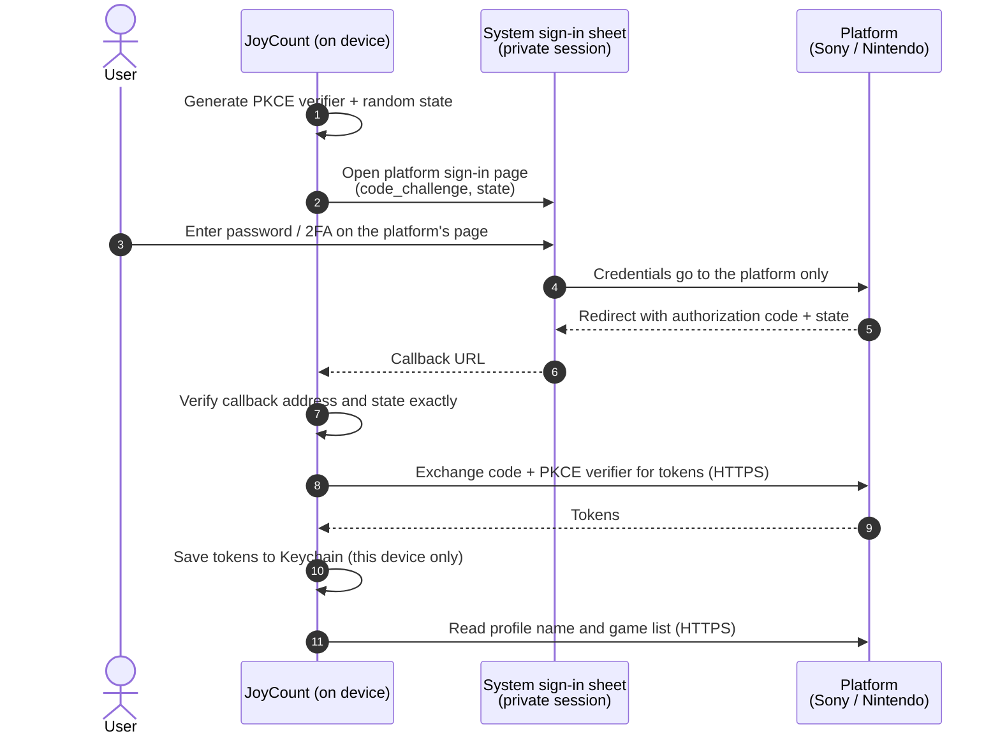
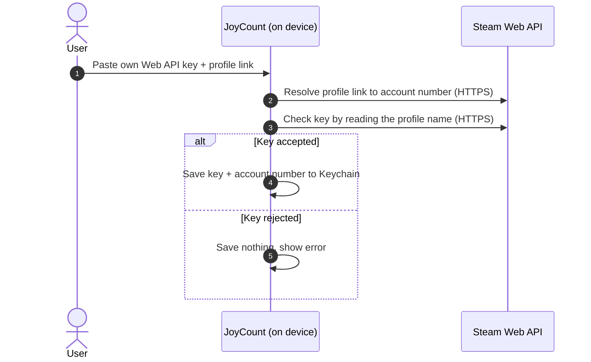

# JoyCount 自动匹配 —— 账号登录安全评估

[English](README.md) · [简体中文](README.zh-Hans.md)

| | |
|---|---|
| **文档编号** | JC-SEC-2026-01 |
| **版本** | 1.2 · 2026 年 10 月 22 日 |
| **产品** | JoyCount（iOS / iPadOS）3.0.2 |
| **组件** | 自动匹配 —— PlayStation、Nintendo Switch、Steam 账号关联 |
| **评估类型** | JoyCount 开发者对源代码进行的自查审计 |
| **状态** | 正式版 |

---

## 目录

1. [摘要](#1-摘要)
2. [范围与方法](#2-范围与方法)
3. [架构与数据流](#3-架构与数据流)
4. [威胁模型](#4-威胁模型)
5. [安全措施与源码佐证](#5-安全措施与源码佐证)
6. [发现的问题](#6-发现的问题)
7. [用户需要了解的剩余风险](#7-用户需要了解的剩余风险)
8. [撤销授权](#8-撤销授权)
9. [报告漏洞](#9-报告漏洞)
10. [修订记录](#10-修订记录)

---

## 1. 摘要

「自动匹配」会读取用户在 PlayStation、Nintendo Switch 和 Steam 上拥有的游戏，方便用户加入 JoyCount 收藏。

本次评估审查了 JoyCount 如何获取、保存、使用和删除这项功能所需的凭据。主要结论：

- **整个过程只涉及两方：用户，以及用户登录的平台。** 自动匹配没有 JoyCount 自己的服务器，所有请求都经 HTTPS 从设备直接发往 Sony、任天堂或 Valve。
- **JoyCount 从不接触用户的平台密码。** PlayStation 与 Nintendo 在平台自己的网页上、于系统的无痕浏览会话中登录；Steam 完全不需要密码。
- **登录回调无法被伪造或截获利用**：每次登录都重新生成 PKCE（S256）与随机 `state`，平台返回时逐项严格校验。
- **凭据只留在本机**：仅存于 iOS 钥匙串，访问级别为「仅限此设备」，绝不写入 iCloud 同步数据、备份、日志或小组件扩展。
- **取消关联会立即删除已保存的凭据。**

本次审查**未发现高危或中危问题**，记录的 **2 项低危**发现均已**修复**，另有 **3 项提示性**发现无需修改（见[第 6 节](#6-发现的问题)）。这些发现均不会让任何其他方读取用户凭据。

## 2. 范围与方法

### 审查范围

| 范围 | 源文件 |
|---|---|
| 登录界面 | `Views/AutoMatchView.swift` |
| PlayStation 登录与游戏库 | `Services/PSNLibraryProvider.swift` |
| Nintendo 登录与游戏库 | `Services/NintendoLibraryProvider.swift` |
| Steam 关联与游戏库 | `Services/SteamLibraryProvider.swift` |
| 凭据存储 | `Services/AutoMatchCredentialStore.swift` |
| 网络客户端 | `Services/AutoMatchHTTPClient.swift` |
| 封面下载 | `Services/AutoMatchCoverFetcher.swift` |
| 账号生命周期 | `Services/AutoMatchCoordinator.swift` |

### 不在范围内

各平台自身的服务器与登录页、iOS 系统本身、自动匹配以外的 JoyCount 功能。

### 方法

1. 逐行人工审查上述全部文件。
2. 列出该组件访问的全部网络地址，并核对其归属平台。
3. 追踪每一项凭据从生成到删除的完整路径。
4. 检查 App 的网络安全设置（App Transport Security）。

本报告中的代码摘录取自被审查的版本，为便于阅读做了删减并将注释译为英文；平台公开的 App 标识等与安全无关的细节已省略。

## 3. 架构与数据流

### 3.1 PlayStation 与 Nintendo



### 3.2 Steam



### 3.3 网络地址

| 平台 | 用途 | 主机 | 归属 |
|---|---|---|---|
| PlayStation | 登录与令牌 | `ca.account.sony.com` | Sony |
| PlayStation | 资料与游戏 | `m.np.playstation.com` | Sony |
| Nintendo | 登录与令牌 | `accounts.nintendo.com`、`api.accounts.nintendo.com` | 任天堂 |
| Nintendo | 游玩记录 | `app-api.znej.nintendo.com` | 任天堂 |
| Nintendo | 商店数据与封面 | `ec.nintendo.com`、`*.cdn.nintendo.net` | 任天堂 |
| Steam | Web API | `api.steampowered.com` | Valve |
| Steam | 封面 | `*.steamstatic.com` | Valve |

自动匹配不会访问其他任何主机。

## 4. 威胁模型

| 编号 | 威胁 | 示例 | 应对措施 | 章节 |
|---|---|---|---|---|
| T1 | App 截取密码 | App 自己显示登录表单 | 只在系统面板中的平台官方页面登录 | 5.1 |
| T2 | 会话复用或串号 | 第二个账号误登成第一个 | 无痕（临时）浏览会话 | 5.1 |
| T3 | 授权码被截获 | 其他 App 注册了相同回调 | PKCE S256 将授权码绑定到本机 | 5.2 |
| T4 | 伪造登录回调（CSRF） | 网页链接带着植入的授权码打开回调 | 随机 `state`，精确比对 | 5.2、5.3 |
| T5 | 凭据被带出设备 | 经 iCloud 同步、备份或文件共享 | 钥匙串「仅限此设备」，绝不进同步数据 | 5.4 |
| T6 | 凭据明文传输 | 公共 Wi-Fi | 仅 HTTPS，由 iOS 强制 | 5.5 |
| T7 | 凭据泄露给其他主机 | 封面服务器收到令牌 | 令牌只发往平台 API 主机 | 5.5 |
| T8 | 凭据残留 | 取消关联后 Key 仍在 | 取消关联即删除钥匙串条目 | 5.6 |
| T9 | 保存了错误的 Key | 输错的 Key 被保存并反复重试 | 保存前先向 Steam 校验 | 5.7 |
| T10 | 服务器文本注入界面 | 误导性的错误信息 | 从不显示平台返回的错误描述 | 5.3 |

## 5. 安全措施与源码佐证

### 5.1 在平台自己的页面、无痕会话中登录（T1、T2）

JoyCount 没有 PlayStation 或 Nintendo 的密码输入框。登录使用 iOS 系统登录面板 `ASWebAuthenticationSession`，App 无法读取或修改用户在其中输入的内容。`prefersEphemeralWebBrowserSession` 让 iOS 开启一个不共享 Cookie 的全新会话，结束后即丢弃。

```swift
// Views/AutoMatchView.swift — AutoMatchWebLogin
private func present(url: URL, scheme: String) async throws -> URL {
    try await withCheckedThrowingContinuation { continuation in
        let session = ASWebAuthenticationSession(url: url, callbackURLScheme: scheme) { callbackURL, error in
            if let error {
                continuation.resume(throwing: error)
            } else if let callbackURL {
                continuation.resume(returning: callbackURL)
            } else {
                continuation.resume(throwing: AutoMatchError.invalidResponse)
            }
        }
        session.presentationContextProvider = AutoMatchPresentationAnchorProvider.shared
        // Private session: no cookies from Safari or from an earlier sign-in.
        session.prefersEphemeralWebBrowserSession = true
        self.session = session
        if !session.start() {
            continuation.resume(throwing: AutoMatchError.server("session"))
        }
    }
}
```

用户离开页面时，未完成的登录会被取消（`onDisappear` 中的 `webLogin.cancel()`）。

### 5.2 每次登录都重新生成 PKCE 与 `state`（T3、T4）

每次登录都会用系统安全随机数生成器新建一个 256 位 PKCE verifier 和一个随机 `state`。登录地址里只有 verifier 的 SHA-256 哈希（challenge）；verifier 本身只保存在内存中，并且只在 HTTPS 换取令牌时发送一次。没有它，截获的授权码毫无用处。

```swift
// Services/PSNLibraryProvider.swift
static func makeAuthorizationRequest() throws -> (url: URL, state: String, codeVerifier: String) {
    let verifier  = try Self.randomURLSafeString(byteCount: 32)   // 256-bit secret, never leaves memory
    let challenge = Self.sha256Base64URL(verifier)                // only the hash is sent
    let state     = try Self.randomURLSafeString(byteCount: 16)

    var components = URLComponents(string: Self.authBase + "/authorize")
    components?.queryItems = [
        URLQueryItem(name: "response_type",         value: "code"),
        URLQueryItem(name: "redirect_uri",          value: Self.redirectURI),
        URLQueryItem(name: "code_challenge",        value: challenge),
        URLQueryItem(name: "code_challenge_method", value: "S256"),
        URLQueryItem(name: "state",                 value: state),
        // client_id and scope omitted
    ]
    guard let url = components?.url else { throw AutoMatchError.invalidURL }
    return (url, state, verifier)
}

static func randomURLSafeString(byteCount: Int) throws -> String {
    var bytes = [UInt8](repeating: 0, count: byteCount)
    // If the system generator ever fails, refuse to sign in rather than
    // fall back to predictable bytes (finding JC-02, fixed).
    guard SecRandomCopyBytes(kSecRandomDefault, byteCount, &bytes) == errSecSuccess else {
        throw AutoMatchError.server("random")
    }
    return Data(bytes).base64URLEncodedString()
}

static func sha256Base64URL(_ input: String) -> String {
    Data(SHA256.hash(data: Data(input.utf8))).base64URLEncodedString()
}
```

Nintendo 使用相同的做法，`state` 为 288 位。任天堂的 PKCE 字段名不同（`session_token_code_challenge`），但保护效果一致。

### 5.3 严格校验登录回调（T4、T10）

平台的回调以 URL 形式返回，其他 App 或网页也可能尝试打开同样的地址，因此 JoyCount 把它视为不可信输入。对于 PlayStation，回调的每一部分都必须完全匹配，才会接受授权码：

```swift
// Services/PSNLibraryProvider.swift
static func authorizationCode(from url: URL, expectedState: String) throws -> String {
    guard let allowed  = URLComponents(string: redirectURI),
          let callback = URLComponents(url: url, resolvingAgainstBaseURL: false),
          callback.scheme?.lowercased() == allowed.scheme?.lowercased(),
          callback.host?.lowercased()   == allowed.host?.lowercased(),
          callback.percentEncodedPath.isEmpty || callback.percentEncodedPath == "/",
          callback.user == nil, callback.password == nil,
          callback.port == nil, callback.fragment == nil,
          !expectedState.isEmpty else {
        throw AutoMatchError.invalidResponse
    }

    let items  = callback.queryItems ?? []
    let states = items.filter { $0.name == "state" }
    let codes  = items.filter { $0.name == "code" }
    let errors = items.filter { $0.name == "error" }

    // Exactly one state, and it must be ours. No duplicated parameters.
    // A reply carries either a code or an error, never both.
    guard states.count == 1, states.first?.value == expectedState,
          codes.count <= 1, errors.count <= 1,
          codes.isEmpty || errors.isEmpty else {
        throw AutoMatchError.invalidResponse
    }

    if let error = errors.first {
        // error_description is untrusted server text: never shown in the UI.
        if error.value == "login_required" || error.value == "invalid_grant" {
            throw AutoMatchError.reauthRequired(.playStation)
        }
        throw AutoMatchError.server(error.value ?? "unknown")
    }

    guard let code = codes.first?.value, !code.isEmpty else {
        throw AutoMatchError.invalidResponse
    }
    return code
}
```

Nintendo 的校验采用相同规则：scheme、host、路径必须匹配，`state` 与授权码都必须恰好出现一次（发现 JC-01，已修复）。

```swift
// Services/NintendoLibraryProvider.swift
// Nintendo returns its parameters in the URL fragment, so fragment and query
// are read together, and each parameter must appear exactly once across both.
let states = items.filter { $0.name == "state" }
let codes  = items.filter { $0.name == "session_token_code" }
guard states.count == 1, states.first?.value == expectedState,
      codes.count == 1, let code = codes.first?.value, !code.isEmpty else {
    throw AutoMatchError.invalidResponse
}
return code
```

### 5.4 钥匙串存储，仅限此设备，绝不同步（T5）

自动匹配的所有凭据都只通过 `AutoMatchCredential` 这一个类型保存，而它只会写入钥匙串，每个已关联账号各占一个条目。

```swift
// Services/AutoMatchCredentialStore.swift
func save(_ credential: AutoMatchCredential, key: String) throws {
    let data = try JSONEncoder().encode(credential)
    let attributes: [String: Any] = [kSecValueData as String: data]
    let updateStatus = SecItemUpdate(baseQuery(key: key) as CFDictionary, attributes as CFDictionary)
    if updateStatus == errSecSuccess { return }
    guard updateStatus == errSecItemNotFound else {
        throw AutoMatchKeychainError(status: updateStatus, operation: "update")
    }

    var addQuery = baseQuery(key: key)
    addQuery[kSecValueData as String] = data
    // Readable after first unlock; never synced to iCloud Keychain,
    // never restored onto a different device.
    addQuery[kSecAttrAccessible as String] = kSecAttrAccessibleAfterFirstUnlockThisDeviceOnly
    let addStatus = SecItemAdd(addQuery as CFDictionary, nil)
    guard addStatus == errSecSuccess else {
        throw AutoMatchKeychainError(status: addStatus, operation: "add")
    }
}
```

设计规则：

- **不与扩展共享。** 这些条目没有声明钥匙串访问组，小组件扩展无法读取。
- **绝不进入 iCloud 同步数据。** 用户可以在「文件」App 中看到 JoyCount 的 iCloud 同步文件，凭据被刻意排除在这一格式之外，同步代码中没有任何对 `AutoMatchCredential` 的引用。
- **账号列表与机密分开。** 已关联账号列表（仅显示名称和账号编号）保存在本地 App 设置中，不含任何令牌或 Key。
- **安全迁移。** 从旧存储格式迁移凭据时，先写入新条目再删除旧条目，失败也不会丢失凭据。

### 5.5 传输安全（T6、T7）

- App **没有声明任何 App Transport Security 例外**（不存在 `NSAppTransportSecurity`），因此 iOS 会在请求发出前拒绝一切非 HTTPS 连接，以及证书无效的 HTTPS 连接。
- 自动匹配的所有地址都是写死的 `https://` 常量，指向对应平台（见 3.3 节）。
- **令牌和 Key 只发往平台 API 主机。** 封面下载器自行构造的请求不携带任何凭据：

```swift
// Services/AutoMatchCoverFetcher.swift
var request = URLRequest(url: cover.url)
request.timeoutInterval = 30
request.setValue("image/*", forHTTPHeaderField: "Accept")   // no Authorization header, no key
let (data, response) = try await session.data(for: request)
```

- App 不在二进制中内置任何凭据，共享的 HTTP 客户端也没有备用 Key，用到的每一项凭据都属于用户本人。

### 5.6 取消关联即删除凭据（T8）

```swift
// Services/AutoMatchCoordinator.swift
func unlink(_ account: AutoMatchAccount) {
    provider(for: account).disconnect()   // SecItemDelete on this account's Keychain item
    AutoMatchAccountStore.remove(account)
    AutoMatchSeenGames.removeBaseline(for: account)
    snapshot.removeAccount(account.id)
    persist()
    reloadAccounts()
    rebuildDrafts()
}
```

删除一个已不存在的条目也视为成功，因此取消关联总能完成。已加入收藏的游戏会保留，因为那是用户自己的记录。

### 5.7 Steam Key 保存前先校验（T9）

```swift
// Services/SteamLibraryProvider.swift
static func link(apiKey: String, accountInput: String, /* … */) async throws -> AutoMatchAccount {
    let trimmedKey = apiKey.trimmingCharacters(in: .whitespacesAndNewlines)
    guard !trimmedKey.isEmpty else { throw AutoMatchError.invalidSteamKey }

    let steamID = try await probe.resolveSteamID(accountInput, apiKey: trimmedKey)
    // Ask Steam for this profile's name with the key. If Steam rejects the key,
    // or the profile does not match, stop here: nothing is written.
    guard let summary = try await probe.playerSummary(steamID: steamID, apiKey: trimmedKey),
          let personaName = summary.personaname, !personaName.isEmpty else {
        throw AutoMatchError.invalidSteamKey
    }

    let account = AutoMatchAccountStore.upsert(
        AutoMatchAccount(platform: .steam, displayName: personaName, externalAccountID: steamID)
    )
    var credential = AutoMatchCredential()
    credential.apiKey      = trimmedKey
    credential.accountID   = steamID
    credential.accountName = personaName
    try credentials.save(credential, for: account)
    return account
}
```

Steam Key 输入框是 `SecureField`：屏幕上隐藏显示，也不会进入系统的自动更正与输入建议。

## 6. 发现的问题

严重程度分四级：**高危**（其他方可以获取凭据）、**中危**（在现实条件下凭据会暴露）、**低危**（纵深防御缺口，但没有已知的暴露路径）、**提示**（设计说明，无需修改）。

| 编号 | 标题 | 严重程度 | 状态 |
|---|---|---|---|
| JC-01 | Nintendo 回调校验不如 PlayStation 严格 | 低危 | **已修复** |
| JC-02 | 未检查安全随机数生成器的返回值 | 低危 | **已修复** |
| JC-03 | Steam Web API Key 位于请求地址中 | 提示 | 接受（平台要求） |
| JC-04 | PlayStation 与 Nintendo 接口并非公开接口 | 提示 | 接受，已向用户说明 |
| JC-05 | 平台返回的封面地址未限定主机列表 | 提示 | 接受 |

「已修复」指源代码已修复，将随 3.0.2 之后的下一次 App Store 更新送达用户。下文的「说明」描述的是 3.0.2 中的行为。

### JC-01 · Nintendo 回调校验不如 PlayStation 严格 —— 低危

**说明。** Nintendo 回调校验会核对 scheme、host 和精确的 `state`，但遇到重复参数时取第一个 `state` 和 `session_token_code`，而不是直接拒绝；也不检查路径。

**影响。** 没有已知的暴露路径。伪造的回调仍需猜中本次登录的随机 `state`，换取令牌时仍需只存在于内存中的 PKCE verifier。

**处理结果。** Nintendo 校验现已采用与 PlayStation 相同的 scheme、host、路径与参数计数规则。`state` 或授权码重复出现（包括在 fragment 与 query 中各出现一次）的回调一律拒绝，并有自动化测试覆盖（见 5.3 节）。

### JC-02 · 未检查安全随机数生成器的返回值 —— 低危

**说明。** `SecRandomCopyBytes` 会返回状态码，目前被忽略（见 5.2 节）。万一调用失败，PKCE verifier 与 `state` 将变得可预测。

**影响。** 在 iOS 上，该调用在正常运行时不会失败；而且攻击者还需同时截获这次登录。

**处理结果。** 两个平台现在都会检查返回值；调用失败时登录会以错误中止，不会向平台发送任何内容（见 5.2 节）。

### JC-03 · Steam Web API Key 位于请求地址中 —— 提示

**说明。** Steam Web API 要求以 `key=` 查询参数传递 Key。

**影响。** 地址在网络上由 HTTPS 加密。JoyCount 不记录请求地址，且只把 Key 发给 `api.steampowered.com`。

**建议。** App 无需修改；用户应像对待密码一样保管 Key（见第 7 节）。

### JC-04 · PlayStation 与 Nintendo 接口并非公开接口 —— 提示

**说明。** 这两个平台没有为 JoyCount 这类 App 提供公开的游戏库接口。自动匹配使用的是平台自家手机 App 的同一套登录与游戏库接口。

**影响。** 这属于可用性问题而非保密性问题：平台随时可能更改或停用接口。App 已向用户说明这一点，接口失效时只会显示错误，绝不会改动用户的收藏。

### JC-05 · 平台返回的封面地址未限定主机列表 —— 提示

**说明。** PlayStation 的封面地址来自平台自己的返回数据，下载时没有限定主机列表。

**影响。** 这些请求不携带任何凭据（见 5.5 节），且地址只来自平台经身份验证的 HTTPS 响应。

## 7. 用户需要了解的剩余风险

- **请像对待密码一样保管 Steam Web API Key。** 一个 Key 可以读取任何**公开**的 Steam 资料，请勿分享或粘贴到其他地方。
- **需要在 Steam 隐私设置中公开游戏详情**，自动匹配才能看到你的游戏。这会让所有人都能看到你的游戏列表，而不只是 JoyCount。
- **能解锁你设备的人**可以像你一样使用 JoyCount。凭据受 iOS 钥匙串和设备密码保护。
- **PlayStation 与 Nintendo 登录可能失效**，如果平台更改了接口（JC-04）。

## 8. 撤销授权

| 位置 | 操作 | 效果 |
|---|---|---|
| JoyCount | 自动匹配 → 账号 → **取消关联** | 立即从钥匙串删除凭据，收藏保留 |
| PlayStation | Sony 账号安全设置 → 退出所有设备，或修改密码 | JoyCount 持有的令牌失效 |
| Nintendo | Nintendo 账号登录与安全设置 → 退出所有设备，或修改密码 | JoyCount 持有的会话失效 |
| Steam | `steamcommunity.com/dev/apikey` → 撤销 Key | Key 立即失效 |

## 9. 报告漏洞

如果你认为自动匹配存在安全问题，请在本仓库提交 Issue，描述问题及复现步骤。**请勿在报告中附上任何令牌、API Key 或密码。**

## 10. 修订记录

| 版本 | 日期 | 变更 |
|---|---|---|
| 1.0 | 2026-10-22 | 首次发布 |
| 1.1 | 2026-10-22 | 新增架构图、威胁模型、源码佐证与正式的发现列表 |
| 1.2 | 2026-10-22 | 修复 JC-01 与 JC-02，更新源码佐证 |
