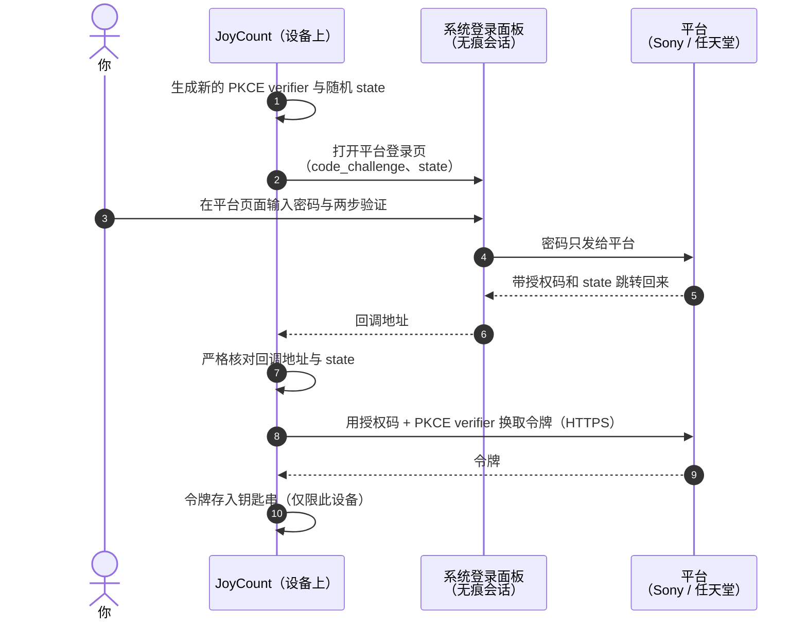
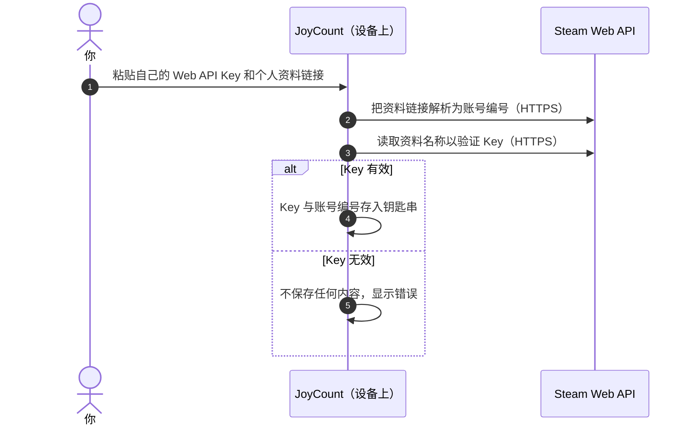
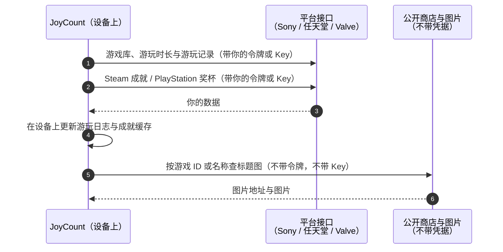

# JoyCount 3.1 安全与隐私报告

[English](README.md) · [简体中文](README.zh-Hans.md)

| | |
|---|---|
| **文档编号** | JC-SEC-2026-02 |
| **版本** | 1.0 · 2026 年 10 月 30 日 |
| **产品** | JoyCount iOS / iPadOS 版 3.1 |
| **评估对象** | 关联账号（PlayStation、Nintendo Switch、Steam），以及使用这些账号的「自动匹配」和新的「统计」页 |
| **评估方式** | JoyCount 开发者对源代码进行的自查 |
| **取代** | JC-SEC-2026-01（3.0.2 版自动匹配登录安全评估） |
| **状态** | 定稿 |

---

## 目录

1. [结论摘要](#1-结论摘要)
2. [3.1 的变化](#2-31-的变化)
3. [范围与方法](#3-范围与方法)
4. [涉及哪些数据](#4-涉及哪些数据)
5. [数据如何流动](#5-数据如何流动)
6. [威胁模型](#6-威胁模型)
7. [安全措施与代码依据](#7-安全措施与代码依据)
8. [发现的问题](#8-发现的问题)
9. [你需要知道的事](#9-你需要知道的事)
10. [删除数据与撤销授权](#10-删除数据与撤销授权)
11. [报告漏洞](#11-报告漏洞)
12. [修订记录](#12-修订记录)

---

## 1. 结论摘要

JoyCount 可以关联你的 PlayStation、Nintendo Switch 和 Steam 账号。**自动匹配**用这些账号找到你拥有的游戏并加入收藏。3.1 中，同一批账号还用于新的**统计**页，显示游玩时长、每日活动和成就。

本次评估的主要结论：

- **JoyCount 没有服务器。** 一切都在你的设备上完成，请求通过 HTTPS 直接从设备发往 Sony、任天堂或 Valve。开发者不会收到你的账号、游玩记录或成就。
- **JoyCount 看不到你的平台密码。** PlayStation 和任天堂在平台自己的页面上登录，使用系统的无痕登录面板。Steam 使用你自己创建的 API Key。
- **凭据只保存在本机钥匙串。** 设为「仅限此设备」：不会同步到 iCloud 钥匙串，不会恢复到其他设备，小组件也读不到；也不会写入 iCloud 同步数据、JoyCount 生成的备份、Excel 导出或诊断日志。
- **统计页没有让凭据去任何新地方。** 新增的游玩时长、奖杯和成就请求，发往的仍是自动匹配原本就在用的 Sony、任天堂和 Valve 服务器。
- **游玩记录与成就留在本机。** 保存在本地文件里，不随 iCloud 同步，断开账号时删除。

本次评估**未发现高危或中危问题**。3.0.2 评估中的两个低危问题（JC-01、JC-02）已修复，3.1 是首个包含这些修复的 App Store 版本。新发现一个低危问题（JC-07），已在发布前修复。另有四个提示性发现无需改代码，详见[第 8 节](#8-发现的问题)。

## 2. 3.1 的变化

| 变化 | 对安全与隐私的影响 |
|---|---|
| **统计页**读取游玩时长、首次 / 最近游玩日期和每日游玩分钟 | 沿用已关联的账号，没有新的登录，也没有新的凭据 |
| **成就与奖杯**（Steam 成就、PlayStation 奖杯） | 新请求发往 `api.steampowered.com` 和 `m.np.playstation.com`，与原来是同一批服务器 |
| **游玩日志**：在设备上逐日记录游玩分钟 | 只存于本机；断开账号时删除该账号的记录 |
| 统计页的**游戏标题图** | 公开商店查询，**不带任何凭据**；其中一项使用社区服务 `api.steamcmd.net`（JC-06） |
| 统计页的**关联账号**页面 | 与自动匹配共用同一批账号和钥匙串项，在一处连接或断开，两处同时生效 |
| 更严格的任天堂登录回调检查（JC-01） | 3.0.2 之后修复，随 3.1 首次发布 |
| 安全随机数返回值检查（JC-02） | 3.0.2 之后修复，随 3.1 首次发布 |
| 断开账号时立即清除成就概况（JC-07） | 在 3.1 中修复 |

## 3. 范围与方法

### 评估范围

| 部分 | 源文件 |
|---|---|
| 登录与账号界面 | `Views/AutoMatchView.swift`、`Views/StatsView.swift` |
| PlayStation 登录、游戏库与奖杯 | `Services/PSNLibraryProvider.swift` |
| 任天堂登录、游戏库与游玩记录 | `Services/NintendoLibraryProvider.swift` |
| Steam 关联、游戏库与成就 | `Services/SteamLibraryProvider.swift` |
| 凭据存储 | `Services/AutoMatchCredentialStore.swift` |
| 网络客户端 | `Services/AutoMatchHTTPClient.swift` |
| 账号生命周期 | `Services/AutoMatchCoordinator.swift` |
| 游玩日志与成就缓存 | `Services/PlayActivityJournal.swift`、`Services/PlayAchievementDetails.swift` |
| 统计页图片 | `Services/StatsArtworkLookup.swift`、`Services/AutoMatchCoverFetcher.swift` |
| 与 iCloud 同步的隔离 | `Services/CloudSyncEngine.swift` |

### 不在范围内

各平台自己的服务器和登录页面；iOS 本身；不使用关联账号的 JoyCount 功能，例如封面搜索、智能导入，以及收藏记录的 iCloud 同步。

### 方法

1. 逐行审阅上述所有文件，包括 3.0.2 以来的全部改动。
2. 列出这些组件访问的每个网络主机，核对归属方以及对方收到的内容。
3. 追踪每一份凭据和每一项游玩数据，从产生到删除。
4. 检查应用的网络安全设置、钥匙串设置和权限（entitlements）。

文中代码摘自 3.1 构建，为便于阅读做了删减。

## 4. 涉及哪些数据

| 数据 | 来源 | 保存位置 | 是否离开设备 |
|---|---|---|---|
| PlayStation / 任天堂登录令牌 | 你在平台页面登录后由平台发放 | 钥匙串，仅限此设备 | 只发给签发它的平台 |
| Steam Web API Key 与 Steam 账号编号 | 你自己粘贴 | 钥匙串，仅限此设备 | 只发给 `api.steampowered.com` |
| 已关联账号列表（名称与账号编号） | 平台 | 本地应用设置 | 否 |
| 游戏库、游玩时长、首次 / 最近游玩 | 平台 | `Application Support/AutoMatch` | 否 |
| 每日游玩分钟（游玩日志） | 根据平台报告在设备上生成 | `Application Support/AutoMatch/play-journal.json` | 否 |
| 成就与奖杯 | Steam 与 PlayStation | `Application Support/AutoMatch` | 否 |
| 图片 | 平台与商店服务器 | `Application Support/AutoMatch` | 否 |

上表中的任何数据都不会发给 JoyCount 开发者。`Application Support` 中的文件和其他应用的数据一样，会包含在 iOS 自身的 iPhone / iPad 备份里；标为「仅限此设备」的钥匙串项不会从备份恢复到另一台设备上。

## 5. 数据如何流动

### 5.1 PlayStation 与任天堂登录



### 5.2 Steam 关联



### 5.3 统计页刷新（3.1 新增）



### 5.4 网络主机

| 平台 | 用途 | 主机 | 归属 | 是否携带凭据 |
|---|---|---|---|---|
| PlayStation | 登录与令牌 | `ca.account.sony.com` | Sony | 是 |
| PlayStation | 资料、游戏、游玩时长、奖杯 | `m.np.playstation.com` | Sony | 是 |
| PlayStation | 商店搜索（标题图） | `web.np.playstation.com` | Sony | 否 |
| 任天堂 | 登录与令牌 | `accounts.nintendo.com`、`api.accounts.nintendo.com` | 任天堂 | 是 |
| 任天堂 | 游玩记录 | `app-api.znej.nintendo.com` | 任天堂 | 是 |
| 任天堂 | 商店数据与图片 | `ec.nintendo.com`、`www.nintendo.com.hk`、`*.cdn.nintendo.net` | 任天堂 | 否 |
| Steam | Web API：游戏库、资料、成就 | `api.steampowered.com` | Valve | 是 |
| Steam | 商店搜索（标题图） | `store.steampowered.com` | Valve | 否 |
| Steam | 图片 | `*.steamstatic.com` | Valve | 否 |
| Steam | 标题 logo 查询 | `api.steamcmd.net` | 社区服务，非 Valve | 否（JC-06） |

这些组件不会访问其他主机。

## 6. 威胁模型

| 编号 | 威胁 | 例子 | 应对 | 章节 |
|---|---|---|---|---|
| T1 | 应用截获密码 | 应用自己做一个登录表单 | 只在平台页面、系统面板中登录 | 7.1 |
| T2 | 会话被复用或串号 | 第二个账号登进了第一个账号 | 无痕登录会话 | 7.1 |
| T3 | 授权码被截获 | 别的应用抢注同一个回调 | PKCE S256 把授权码绑定到这次登录 | 7.2 |
| T4 | 伪造的登录回复 | 网页链接带着预置的授权码打开回调 | 随机 `state`，严格核对 | 7.2、7.3 |
| T5 | 凭据被带离设备 | 通过 iCloud 同步、备份或文件共享 | 钥匙串、仅限此设备，不进同步数据 | 7.4 |
| T6 | 凭据明文传输 | 公共 Wi-Fi | 只用 HTTPS，由 iOS 强制 | 7.5 |
| T7 | 凭据发错主机 | 图片服务器收到令牌 | 凭据只发往平台接口主机 | 7.5、7.6 |
| T8 | 断开后数据残留 | Key 或游玩记录还在 | 断开即删除凭据、游玩日志与成就数据 | 7.7 |
| T9 | 游玩记录被擅自共享 | 活动被同步或上传 | 游玩数据只在本地文件，不同步、不上传 | 7.8 |
| T10 | 服务器文字显示在应用里 | 误导性错误信息 | 从不显示平台返回的错误描述 | 7.3 |

## 7. 安全措施与代码依据

### 7.1 在平台自己的页面、无痕会话中登录（T1、T2）

JoyCount 没有 PlayStation / 任天堂的密码输入框，使用的是 iOS 系统登录面板 `ASWebAuthenticationSession`，应用无法读取或修改其中内容。开启 `prefersEphemeralWebBrowserSession` 后，iOS 会开一个不共享 Cookie 的干净会话，用完即丢弃。

```swift
// Views/AutoMatchView.swift — AutoMatchWebLogin
let session = ASWebAuthenticationSession(url: url, callbackURLScheme: scheme) { callbackURL, error in
    // …
}
session.presentationContextProvider = AutoMatchPresentationAnchorProvider.shared
// 无痕会话：不带 Safari 或上一次登录的 Cookie。
session.prefersEphemeralWebBrowserSession = true
```

统计页没有另做一套登录，它的「关联账号」页打开的就是自动匹配的同一套账号页面。

### 7.2 每次登录都重新生成 PKCE 与 `state`（T3、T4）

每次登录都用系统安全随机数生成新的 256 位 PKCE verifier 和随机 `state`，登录地址里只带 verifier 的 SHA-256 哈希。随机数生成失败时直接停止登录，不会退回可预测的值（JC-02，已修复）。

```swift
// Services/PSNLibraryProvider.swift
let verifier  = try Self.randomURLSafeString(byteCount: 32)   // 256 位秘密，只在内存中
let challenge = Self.sha256Base64URL(verifier)                // 只发送哈希
let state     = try Self.randomURLSafeString(byteCount: 16)

static func randomURLSafeString(byteCount: Int) throws -> String {
    var bytes = [UInt8](repeating: 0, count: byteCount)
    guard SecRandomCopyBytes(kSecRandomDefault, byteCount, &bytes) == errSecSuccess else {
        throw AutoMatchError.server("random")
    }
    return Data(bytes).base64URLEncodedString()
}
```

任天堂用同样的做法，`state` 为 288 位。

### 7.3 严格核对登录回复（T4、T10）

回复以地址的形式到达，任何应用或网页都可能尝试打开它，所以 JoyCount 把它当作不可信输入。PlayStation 和任天堂都要求协议、主机和路径完全一致，`state` 与授权码各自恰好出现一次。任天堂的检查在 3.0.2 之后提升到了这一标准（JC-01，已修复）。

```swift
// Services/NintendoLibraryProvider.swift
// 任天堂把参数放在 URL fragment 里，所以 fragment 和 query 一起读，
// 每个参数在两处加起来必须恰好出现一次。
let states = items.filter { $0.name == "state" }
let codes  = items.filter { $0.name == "session_token_code" }
guard states.count == 1, states.first?.value == expectedState,
      codes.count == 1, let code = codes.first?.value, !code.isEmpty else {
    throw AutoMatchError.invalidResponse
}
```

平台返回的错误描述从不显示在应用里。

### 7.4 钥匙串存储，仅限此设备，从不同步（T5）

所有凭据都通过同一个类型 `AutoMatchCredential` 写入钥匙串，每个关联账号一项。这部分代码自 3.0.2 以来没有改动。

```swift
// Services/AutoMatchCredentialStore.swift
var addQuery = baseQuery(key: key)
addQuery[kSecValueData as String] = data
// 首次解锁后可读；不同步到 iCloud 钥匙串，不会恢复到其他设备。
addQuery[kSecAttrAccessible as String] = kSecAttrAccessibleAfterFirstUnlockThisDeviceOnly
```

- **未声明钥匙串访问组**，小组件扩展读不到这些项。
- **不进 iCloud 同步数据、Excel 备份或诊断日志**，这些代码都没有引用 `AutoMatchCredential`。
- **账号列表不含秘密**，只保存显示名称和账号编号。

### 7.5 传输安全（T6、T7）

- 应用**没有声明任何 App Transport Security 例外**，iOS 会拒绝一切非 HTTPS 或证书无效的连接。
- [5.4 节](#54-网络主机)中的每个地址都是固定的 `https://` 常量。
- 请求地址、令牌和 Key 都不写入日志。

### 7.6 统计页的图片请求不带凭据（T7）

统计页的标题图从公开商店查询，这些请求不带任何令牌或 Key。例如 Steam logo 查询：

```swift
// Services/StatsArtworkLookup.swift
guard let url = URL(string: "https://api.steamcmd.net/v1/info/\(appID)") else { throw AutoMatchError.invalidURL }
// 不加任何请求头：没有令牌，没有 Steam Key，只发送公开的游戏 ID。
let envelope = try await AutoMatchHTTPClient().getJSON(url, as: SteamCMDEnvelope.self, timeout: 10)
```

图片下载使用只请求图片的普通请求：

```swift
// Services/AutoMatchCoverFetcher.swift
var request = URLRequest(url: url)
request.setValue("image/*", forHTTPHeaderField: "Accept")   // 无 Authorization 头，无 Key
```

### 7.7 断开账号即删除凭据与游玩数据（T8）

```swift
// Services/AutoMatchCoordinator.swift
func unlink(_ account: AutoMatchAccount) {
    provider(for: account).disconnect()          // 删除该账号的钥匙串项
    AutoMatchAccountStore.remove(account)
    AutoMatchSeenGames.removeBaseline(for: account)
    snapshot.removeAccount(account.id)           // 只属于该账号的游戏
    persist()
    PlayActivityJournalStore.prune(account: account.id, platform: platform, keeping: snapshot.games)
    PlayAchievementDetailStore.removeAccount(account.id)   // 逐个游戏的成就列表
    PlayAchievementStore.removeAccount(account.id)         // 成就概况（JC-07，已修复）
    reloadAccounts()
    rebuildDrafts()
}
```

删除一个已经不存在的项也算成功，所以断开总能完成。已经加入收藏的游戏会保留，因为那是你自己的记录。

### 7.8 游玩数据留在本机（T9）

游玩日志、成就缓存和统计页图片缓存都是应用 `Application Support/AutoMatch` 文件夹里的普通本地文件。它们不属于 JoyCount 的 iCloud 同步格式，不包含在 Excel 导出中，也从不上传。JoyCount 不对这些数据做任何统计分析或追踪。

### 7.9 Steam Key 先验证再保存

关联 Steam 时，JoyCount 会先用这个 Key 向 Steam 读取你的资料名称。Steam 拒绝该 Key 或资料不匹配时，不保存任何内容。Key 输入框是 `SecureField`，屏幕上隐藏显示，也不会进入自动更正和输入建议。

## 8. 发现的问题

严重程度分四级：**高危**（他人可获取凭据或私人数据）、**中危**（在现实条件下会泄露）、**低危**（纵深防御上的缺口，没有已知的泄露途径）、**提示**（设计说明，无需修改）。

| 编号 | 标题 | 严重程度 | 状态 |
|---|---|---|---|
| JC-01 | 任天堂回调检查不如 PlayStation 严格 | 低危 | **已修复，随 3.1 首次发布** |
| JC-02 | 未检查安全随机数生成器的返回值 | 低危 | **已修复，随 3.1 首次发布** |
| JC-07 | 断开账号后，成就概况要到下次刷新统计页才清除 | 低危 | **已在 3.1 修复** |
| JC-03 | Steam Web API Key 放在请求地址中 | 提示 | 接受（Steam 的要求） |
| JC-04 | PlayStation 与任天堂接口不公开 | 提示 | 接受，已向用户说明 |
| JC-05 | 平台给出的图片地址未限定主机 | 提示 | 接受 |
| JC-06 | Steam 标题 logo 通过社区服务查询 | 提示 | 接受，在此说明 |

### JC-01 · 任天堂回调检查不如 PlayStation 严格 —— 低危 · 已修复

3.0.2 中，任天堂的检查取第一个找到的 `state` 和授权码，也不检查路径。伪造的回复仍需要正确的随机 `state` 和 PKCE verifier，因此没有已知的泄露途径。现在的检查与 PlayStation 一致（7.3 节），并有自动化测试覆盖。

### JC-02 · 未检查安全随机数生成器的返回值 —— 低危 · 已修复

3.0.2 中忽略了 `SecRandomCopyBytes` 返回的状态。这个调用在 iOS 上没有已知的失败情况。现在会检查返回值，失败时登录直接报错停止（7.2 节）。

### JC-07 · 断开账号后，成就概况要到下次刷新统计页才清除 —— 低危 · 已修复

**说明。** 3.1 开发版中，断开账号会立即删除凭据、游玩日志和逐个游戏的成就列表，但该账号的成就概况（`achievements.json`）要等下一次刷新统计页才会删除。

**影响。** 文件一直留在设备上应用自己的存储里，不含凭据，也从未发送到任何地方。

**处理。** 现在断开账号会立即从成就概况中删除该账号的条目（7.7 节）。已在 3.1 发布前修复。

### JC-03 · Steam Web API Key 放在请求地址中 —— 提示

Steam Web API 要求 Key 以 `key=` 查询参数传递。HTTPS 会加密整个地址，JoyCount 不记录请求地址，Key 也只发给 `api.steampowered.com`。请像对待密码一样对待这个 Key（第 9 节）。

### JC-04 · PlayStation 与任天堂接口不公开 —— 提示

这两个平台没有为 JoyCount 这类应用提供公开接口。JoyCount 使用的是平台自家手机应用所用的登录与数据接口。这关系到可用性，而不是保密性：平台随时可能修改或屏蔽这些接口。失败时只会显示错误，不会改动你的收藏。应用在关联前会告诉你这一点。

### JC-05 · 平台给出的图片地址未限定主机 —— 提示

部分图片地址来自平台自己的 HTTPS 回复，下载时没有限定主机。这些下载不带任何凭据（7.6 节）。

### JC-06 · Steam 标题 logo 通过社区服务查询 —— 提示

**说明。** 统计页显示游戏标题 logo 时，JoyCount 会先尝试 Valve 自己的固定 logo 地址。有些游戏的 logo 文件名无法从 Steam 公开 Web API 得到，只有这些游戏才会去问 `api.steamcmd.net`——一个镜像 Steam 公开应用信息的社区服务。

**影响。** 请求里只有你玩过的某个游戏的公开 Steam 应用 ID，不含令牌、Key 或账号编号。和任何网站一样，该服务能看到你的 IP 地址，因此理论上能知道这个地址查询了哪些 Steam 游戏，但无法把它和你的 Steam 账号联系起来。

**建议。** 无需修改。查询结果缓存在设备上，同一个游戏不会频繁重复查询。该服务不可用时，统计页会以文字显示游戏名称，而不是 logo。

## 9. 你需要知道的事

- **像对待密码一样对待 Steam Web API Key。** 不要分享，也不要粘贴到其他地方。
- **Steam 的游戏详情需要设为公开**，JoyCount 才能读取你的游戏和游玩时长。这也意味着任何人都能看到，而不只是 JoyCount。
- **能解锁你设备的人**，也能像你一样打开 JoyCount。你的数据由 iOS 钥匙串和设备密码保护。
- **PlayStation 与任天堂的访问可能失效**，如果平台修改了接口（JC-04）。
- **统计页的游玩记录只包含平台报告的内容。** 任天堂只报告大约最近一周的每日分钟数。JoyCount 会在设备上逐步积累更长的记录，这些记录从不离开设备。

## 10. 删除数据与撤销授权

| 位置 | 操作 | 效果 |
|---|---|---|
| JoyCount | 统计 → 关联账号，或 自动匹配 → 账号 → **断开** | 从钥匙串删除凭据；删除该账号的游玩日志、成就以及只属于它的游戏；你的收藏记录保留 |
| JoyCount | 删除应用 | 应用文件（包括游玩数据）被删除。iOS 可能在删除应用后保留钥匙串项，因此请**先断开账号**，确保凭据已删除 |
| PlayStation | Sony 账号安全设置 → 从所有设备登出，或修改密码 | JoyCount 持有的令牌失效 |
| 任天堂 | 任天堂账号的登录与安全设置 → 从所有设备登出，或修改密码 | JoyCount 持有的会话失效 |
| Steam | `steamcommunity.com/dev/apikey` → 撤销 Key | Key 立即失效 |

## 11. 报告漏洞

如果你认为发现了 JoyCount 的安全或隐私问题，请在本仓库提交 issue，说明问题和复现方法。**请勿在报告中包含任何令牌、API Key 或密码。**

## 12. 修订记录

| 文档 | 版本 | 日期 | 变更 |
|---|---|---|---|
| JC-SEC-2026-02 | 1.0 | 2026-10-30 | JoyCount 3.1 新报告。涵盖统计页与关联账号，新增隐私数据清单、JC-06 与 JC-07，并说明 JC-01、JC-02 在正式版本中的状态。 |
| JC-SEC-2026-01 | 1.0–1.2 | 2026-10-22 | 3.0.2 版自动匹配登录安全评估。已由本报告取代，仍可在本仓库历史中查看。 |
